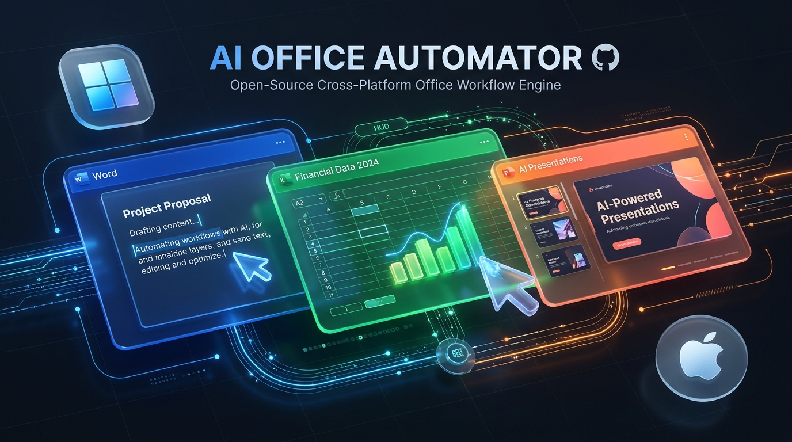

# microsoft-wps-live-mcp

[English](README.md) | [中文说明](README_CN.md)



A universal, local Office Model Context Protocol (MCP) server that empowers AI agents to create, inspect, and interactively live-edit Word, Excel, and PowerPoint documents in **Microsoft Office and WPS Office**.

If a document is already open, it seamlessly connects to the active desktop window; if closed, it opens the file directly in the native office suite. Built for professional work, academic research, data analysis, and daily productivity without arbitrary task or domain whitelists.

**Dual-Platform Native Support: Windows & macOS**
- **Windows**: Full COM automation directly driving desktop Microsoft Office and COM-enabled WPS Office.
- **macOS**: Native AppleScript and application bridge supporting Microsoft Office (Word, Excel, PowerPoint) and WPS Office for macOS.

## Features

- **Standard stdio MCP**: Built on the official Python MCP SDK, providing 37 specialized tools with both modern and legacy protocol negotiation.
- **Visible, Step-by-Step Execution by Default**: Documents open in real desktop windows. The view actively tracks paragraphs, cell ranges, or slides as content takes shape in real time. Complex tasks run in named stages with progress reporting and automatic checkpoints.
- **Zero-Takeover Native Editing**: The agent invokes standard MCP tools while you watch and continue editing in your familiar Office/WPS window. No screen capture, remote desktop takeover, or separate web preview portals required.
- **Universal Object Model**: Inspect native type libraries, discover enums and constants, and batch compose get/set properties or invoke methods, returning reusable native object references.
- **Comprehensive Word Tools**: Text insertion, search & replace, table generation, comments, tracked changes (revisions), footnotes, endnotes, bookmarks, fields, cross-references, math equations, images, and snapshot diffs.
- **Excel & PowerPoint Capabilities**: Cell values and formulas, cell styling and formatting, worksheet management; PPT slides, text shapes, and layout formatting; comprehensive component inventory and direct vector PDF export across all three formats.
- **Advanced Native Components**: Full access to native shapes, connectors, flowcharts, data charts, themes, masters, and tables. Includes working examples for editable flowcharts and live Excel charts.
- **Auto-Save with Integrity Verification**: Automatically saves to disk upon successful modification with SHA256 checksum verification. An idle observer (~1s) detects and saves manual user edits during active MCP sessions.
- **Isolated Recovery & Version Backups**: Keeps pre-edit version backups in `backups/`, updates independent crash-recovery copies in `recovery/` on each save, and generates clean sibling copies via `office_create_copy` without altering the original file path.
- **Transparent Error Handling**: Clearly surfaces file conflicts, read-only locks, and partial failures without falsely claiming unsaved edits are saved.

Detailed interface coverage and audit logs are documented in [COMPATIBILITY.md](docs/COMPATIBILITY.md) and [FEATURE_AUDIT.md](docs/FEATURE_AUDIT.md).

## Installation

Requires Windows or macOS, Python 3.11+, and desktop Microsoft Office or WPS Office. The source can be placed in any directory with write permissions. The native MCP server **does not require WSL, Docker, or ONLYOFFICE**.

### Windows (PowerShell)

In the repository root, run:

```powershell
powershell -NoProfile -File .\scripts\setup-mcp.ps1
```

Or install manually:

```powershell
python -m venv .venv
.\.venv\Scripts\python.exe -m pip install .
.\.venv\Scripts\python.exe -m microsoft_wps_live_mcp --doctor
.\.venv\Scripts\python.exe -m microsoft_wps_live_mcp --write-configs .\config\clients
```

### macOS / Linux (Bash)

In the repository root, run:

```bash
chmod +x ./scripts/setup-mcp.sh
./scripts/setup-mcp.sh
```

Or install manually:

```bash
python3 -m venv .venv
./.venv/bin/python -m pip install .
./.venv/bin/python -m microsoft_wps_live_mcp --doctor
./.venv/bin/python -m microsoft_wps_live_mcp --write-configs ./config/clients
```

Standard `pip` or `uv` installation is also supported. Once installed, start the server with `microsoft-wps-live-mcp` or `python -m microsoft_wps_live_mcp`. It communicates via standard input/output (stdio) and does not listen on any network ports.

## Connecting to AI Agent Clients

Configuration generators are provided for Codex, Claude Desktop / Claude Code, Google Gemini CLI / Antigravity, Kimi Code, ZCode, WorkBuddy, DeepSeek Harness, Trae, Qoder, and standard stdio MCP clients.

```powershell
# Windows
.\.venv\Scripts\python.exe -m microsoft_wps_live_mcp --config codex
.\.venv\Scripts\python.exe -m microsoft_wps_live_mcp --config claude-code
.\.venv\Scripts\python.exe -m microsoft_wps_live_mcp --config deepseek-harness

# macOS
./.venv/bin/python -m microsoft_wps_live_mcp --config claude-code
```

Merge the generated configuration block into your client's MCP configuration file, then start a new session. See [Client Setup Guide](docs/CLIENTS.md).

## Usage

You can ask the AI agent to perform any suitable Office task, such as financial balance sheets, project flowcharts, academic charts, study notes, business reports, or document proofreading.

1. Call `office_status` to inspect registered desktop suites and open documents.
2. Use `office_open_document` or `office_create_document` to connect to a file. `engine` options: `microsoft`, `wps`, or `auto` (follows currently open app; for closed files, prefers Microsoft, then WPS).
3. The subsequent `document` argument accepts a document ID or an absolute file path. Paragraphs, worksheets, slides, and shapes use **1-based** indexing; Word character offsets use native **0-based** offsets.
4. `office_open_document` and `office_create_document` default to `visible=true`. Long text blocks in Word and row blocks in Excel are paced to update the native window smoothly. Only use `visible=false` if the user explicitly requests background work.
5. For complex tasks, use `office_live_steps` to divide work into stages (e.g. "Structure → Content → Components → Formatting"). Use `office_show_document` to highlight the current area. See [Live Editing Guide](docs/LIVE_EDITING.md).
6. For advanced features not covered by convenience tools, use `office_api_describe`, `office_api_constants`, and `office_api_batch` to explore and compose native operations. See [Object Model Guide](docs/OBJECT_MODEL.md) and [examples](examples/).

## Auto-Save & Recovery Architecture

Only explicitly connected documents are managed; other open documents discovered in the background are never modified without instruction.

The tools return `disk_saved`, SHA256 checksum, auto-save status, and recovery copy paths. The application's internal `saved` flag and disk verification are reported separately. External disk changes or partial execution errors pause auto-save; inspecting the state and explicitly saving resumes auto-saving.

The default data directory is `%LOCALAPPDATA%\microsoft-wps-live-mcp` on Windows, and `~/Library/Application Support/microsoft-wps-live-mcp` on macOS. It can be customized via `MICROSOFT_WPS_LIVE_MCP_DATA` or the `--data-dir` flag.

| Location | Purpose |
| --- | --- |
| `backups/` | Pre-edit disk versions; retains the initial version and the 49 most recent versions per document |
| `recovery/` | Independent recovery copy updated immediately after every confirmed save |
| `office_create_copy` output | Final completed copy generated beside the original file with a unique name without modifying the original path |

Agents should call `office_create_copy` before concluding an editing task, providing both original and final copy locations to the user.

## Testing & Verification

Automated offline unit tests (does not require Office installation):

```bash
python -B -m unittest discover -s tests -v
```

Interactive desktop tests with live Office/WPS applications (outputs to git-ignored `data/`):

```powershell
python .\scripts\smoke_native.py --engine all
python .\scripts\smoke_mcp.py --engine all
python .\scripts\smoke_mcp.py --engine all --mode legacy
python .\scripts\smoke_features.py --engine all
python .\scripts\smoke_live.py --engine all
```

GitHub Actions executes the offline test suite across Windows, macOS, and Linux runners.

## Source Export

```powershell
python .\scripts\export_source.py
```

Generates `dist/microsoft-wps-live-mcp-source.zip`, packaging only reviewed source code, documentation, examples, and tests while excluding runtime data, environments, credentials, and backups.

## Web Editor Mode (Optional)

The legacy ONLYOFFICE web editor and preview bridge remains available as a separate entry point; it does not control desktop Microsoft Office or WPS Office. See [Web Editor Guide](docs/WEB_EDITOR.md).

This repository does not distribute Microsoft Office, WPS Office, or ONLYOFFICE installers or licenses. All third-party software and dependencies are subject to their respective upstream licenses.
